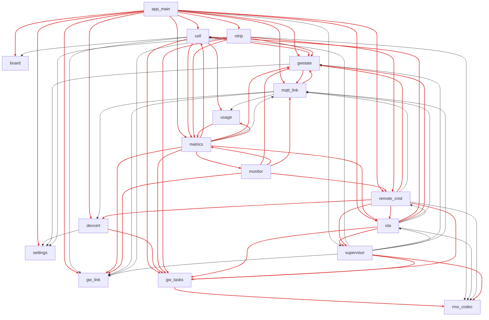

# rmx-mower-gateway: include graph as it is

Generated with `generate_diagrams.py --as-is` from the code at rmx-lt/rmx-mower-gateway `725a2ce` and `architecture.yaml` in this folder.

Includes between components in the code now: 69 edges, 47 not in the manifest (red), 6 upward.

