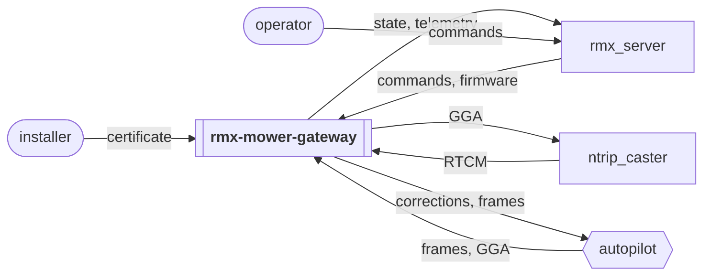
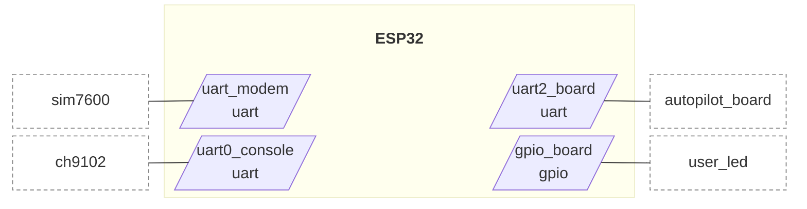
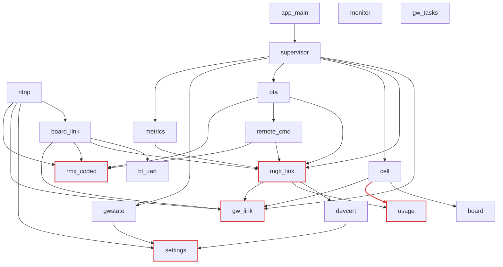
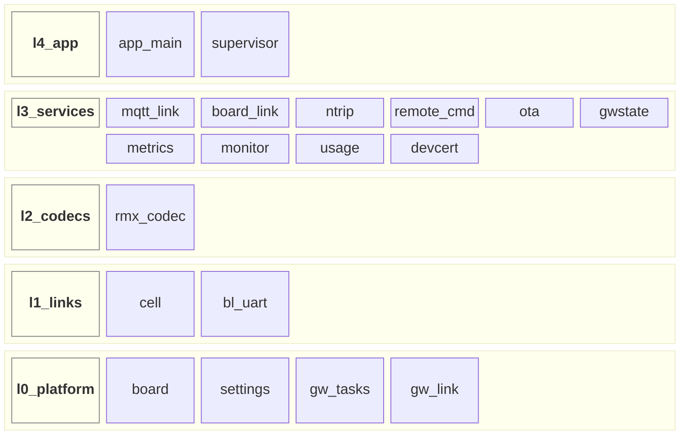

<!-- esp-architecture:diagrams begin: generated from architecture.yaml by generate_diagrams.py, do not edit -->

## Context

The device and the world around it.

## Block

Level 1, hardware: the processor, its buses on its edges and the devices outside on them.

## Organigram

Who calls whom, from the top down (`depends_on`). Red boxes: used by more than one component (gw_link, mqtt_link, usage, rmx_codec, settings); a shared resource needs care against contention. Red arrows: 1 upward, which the layers forbid.

| Task | Component | Priority | Stack |
|---|---|---|---|
| `ntrip` | ntrip | 6 | 4096 |
| `cell_wd` | cell | 5 | 4096 |
| `remote_cmd` | remote_cmd | 4 | 6144 |
| `supervisor` | supervisor | 3 | 6144 |
| `gw_tick` | metrics | 3 | 6144 |
| `ota` | ota | 3 | 12288 |
| `devcert` | devcert | 3 | 6144 |
| `gw_signal` | metrics | 2 | 4096 |

## Layering

Layers from the top (application) to the bottom (platform).

| Layer | Holds |
|---|---|
| `l4_app` | Init order and the supervisor |
| `l3_services` | MQTT, board link, NTRIP, commands, OTA, state, metrics |
| `l2_codecs` | Pure C, no ESP-IDF or FreeRTOS includes, host-tested |
| `l1_links` | Modem and PPP, board UART |
| `l0_platform` | Pins, NVS, task table, link state |

<!-- esp-architecture:diagrams end -->
