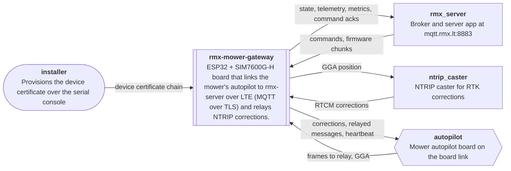
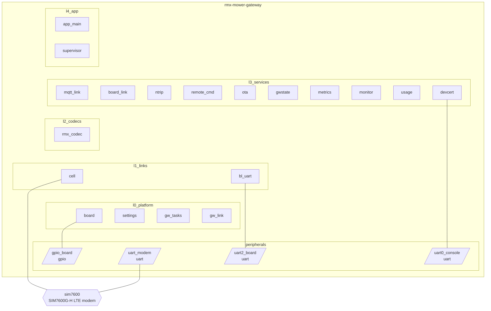
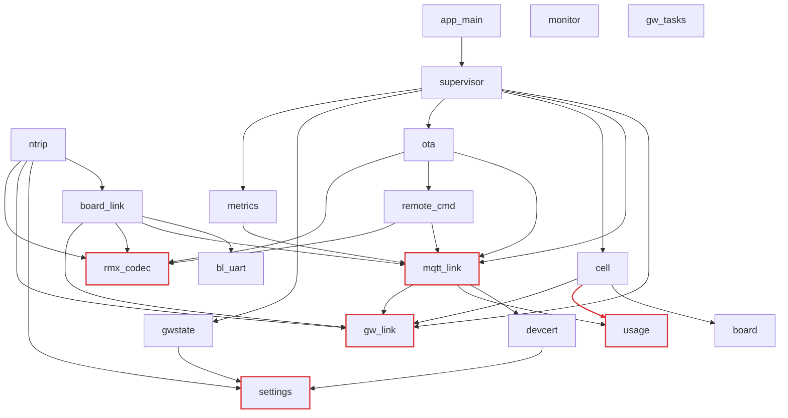
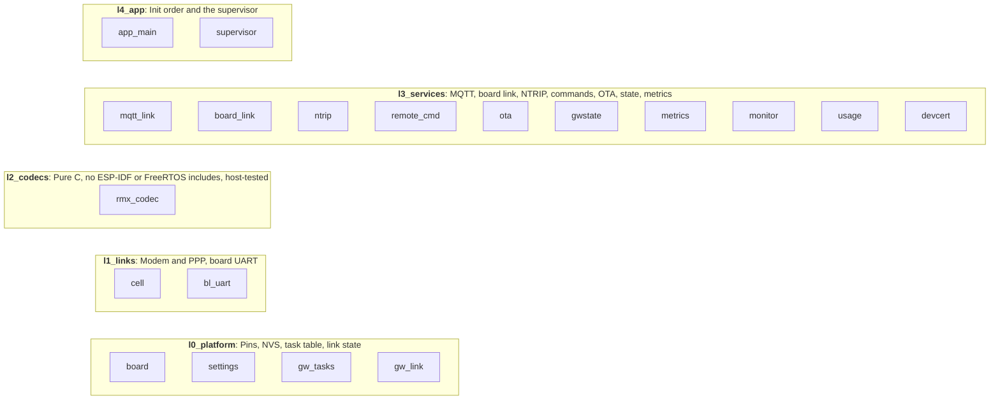

<!-- esp-architecture:diagrams begin: generated from architecture.yaml by generate_diagrams.py, do not edit -->

## Context

The device and the world around it.

## Block

Inside the chip: components and the buses they drive; outside: devices on those buses.

| Task | Component | Priority | Stack |
|---|---|---|---|
| `ntrip` | ntrip | 6 | 4096 |
| `cell_wd` | cell | 5 | 4096 |
| `remote_cmd` | remote_cmd | 4 | 6144 |
| `supervisor` | supervisor | 3 | 6144 |
| `gw_tick` | metrics | 3 | 6144 |
| `ota` | ota | 3 | 12288 |
| `devcert` | devcert | 3 | 6144 |
| `gw_signal` | metrics | 2 | 4096 |

## Organigram

Who calls whom, from the top down (`depends_on`). Red boxes: used by more than one component (gw_link, mqtt_link, usage, rmx_codec, settings); a shared resource needs care against contention. Red arrows: 1 upward, which the layers forbid.

## Layering

Layers from the top (application) to the bottom (platform).

<!-- esp-architecture:diagrams end -->
