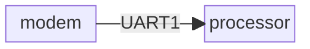
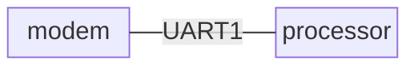
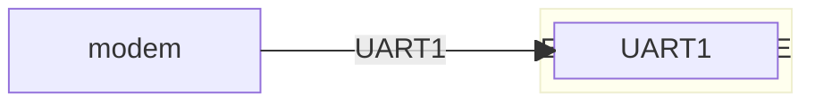
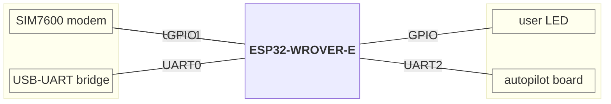

# Block diagram in block-beta: scratch

Scratch branch for redrawing the block diagram step by step. Not for merging.

## Test: edge labels

A. Labelled arrow, the docs' syntax `a -- "UART1" --> b`:

B. Labelled line without an arrowhead, `a -- "UART1" --- b`:

C. Composite block with a title, `block:cpu["ESP32-WROVER-E"]`:

## Step 1: level 1a, hardware

The processor and the devices outside it, one line per bus. The ESP32-WROVER-E module has integrated 16 MB flash and 8 MB PSRAM.

