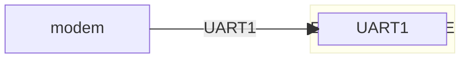
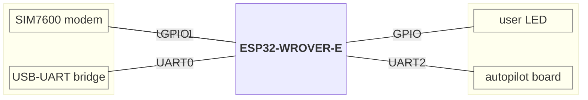
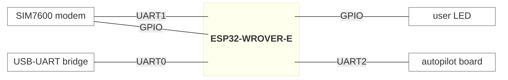
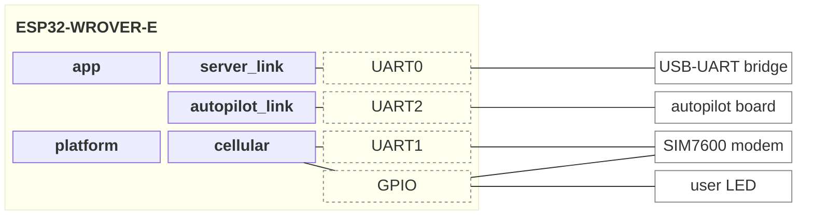
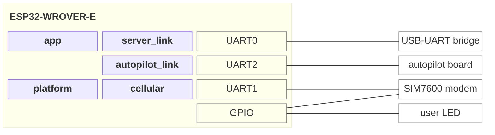
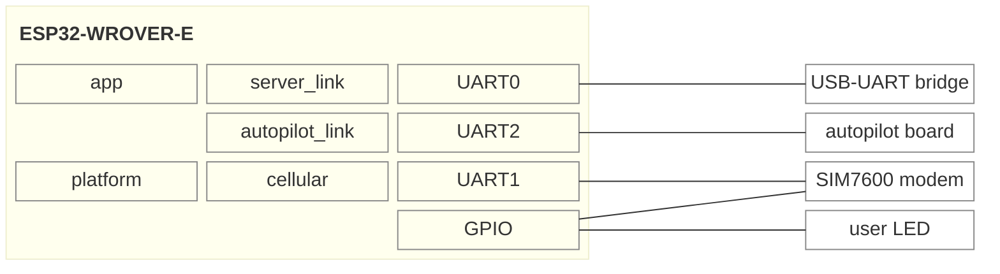

# Block diagram in block-beta: scratch

Scratch branch for redrawing the block diagram step by step. Not for merging.

## Test: edge labels

A. Labelled arrow, the docs' syntax `a -- "UART1" --> b`:

B. Labelled line without an arrowhead, `a -- "UART1" --- b`:

C. Composite block with a title, `block:cpu["ESP32-WROVER-E"]`:

## Step 1: level 1a, hardware

The processor and the devices outside it, one line per bus. The ESP32-WROVER-E module has integrated 16 MB flash and 8 MB PSRAM.

### Step 1, v2

v1 problems: the SIM7600's two lines join the same two boxes, so they overlap ("tGPIOI"); the device groups get a yellow composite fill. v2: the processor is a composite of three invisible rows, so each line ends at its own height; the groups have no fill or border.

## Level 2, subsystems: v1

1a and 1b stay as they are (flowcharts). Level 2 in block-beta, as a grid inside the processor: the subsystems that drive no bus (app, platform) in the inner column, each bus-driving subsystem in the middle column on the same row as its bus, the bus boxes at the processor's edge, and the devices outside, on their bus's row.

## Level 2, subsystems: v2

v1 changes, from the user: no lines inside the processor, and every box solid. Placement alone ties a subsystem to the bus beside it; lines only leave the processor, from a bus to its devices.

## Level 2, subsystems: v3

v2 change, from the user: one style for every box. Subsystems, buses and devices are all plain outlines with plain labels; only the processor's title is bold.

