# Block diagram in block-beta: scratch

Scratch branch for redrawing the block diagram step by step. Not for merging.

Newest first: the latest version is at the top, the oldest at the bottom.

## Level 2, subsystems: v19

v18 left a strip under autopilot_link. Mermaid sizes each row from its own content (cellular's holds three stacked cells: UART1, gap, GPIO; the others two or one), then stretches the shorter rows without growing their boxes. v19 gives every row the same three stacked cells: UART0 or UART2 and two gaps, and three gaps beside app.

The processor: ESP32-WROVER-E.

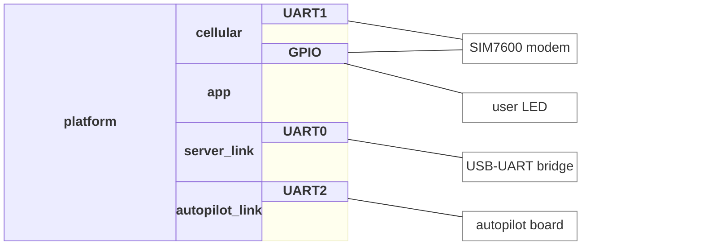

## Level 2, subsystems: v18

v15 change, from the user: platform shorter. platform is as tall as the column beside it, which held the title row on top, and an empty strip at the bottom: Mermaid made the autopilot_link row as tall as the cellular row without growing autopilot_link and UART2. v18: no title box (a box can't sit above platform without becoming as tall as the whole body, as in v14), so the processor is named in the text; autopilot_link gets UART2 and a gap, like server_link, so its row fills. platform now runs exactly from cellular to autopilot_link.

The processor: ESP32-WROVER-E.

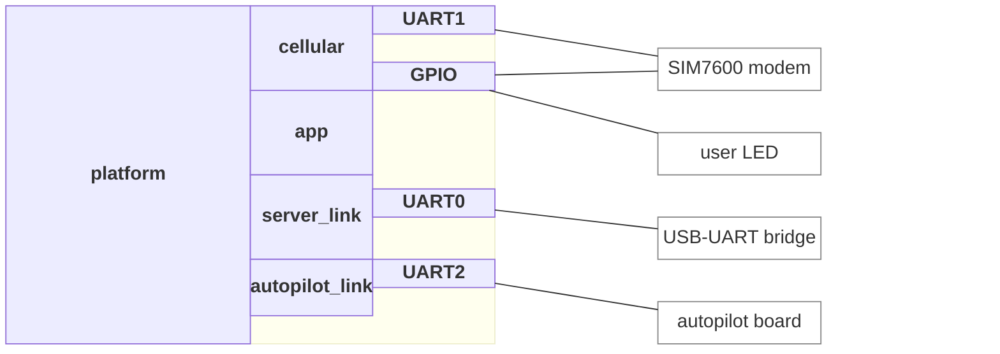

## Level 2, subsystems: v17

v16 broke: the subsystem column lost its two-column span and the buses stuck out of the processor. Same Mermaid bug as v6 to v12: a block that has to stretch to a wider neighbour (here the devices block) keeps its spanning children narrow. v17 keeps the devices block narrower than the processor: two columns (a gap, then the device) and device names on two lines.

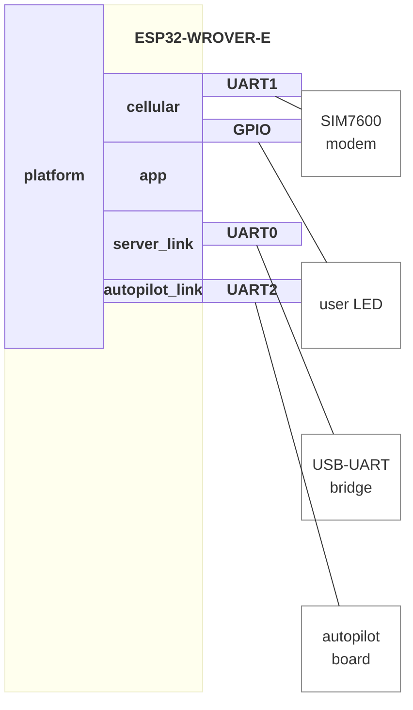

## Level 2, subsystems: v16

v15 change, from the user: platform narrower. Both columns of a group get the same width, so the processor block now has three columns and the subsystem column spans two: platform is a third of the width.

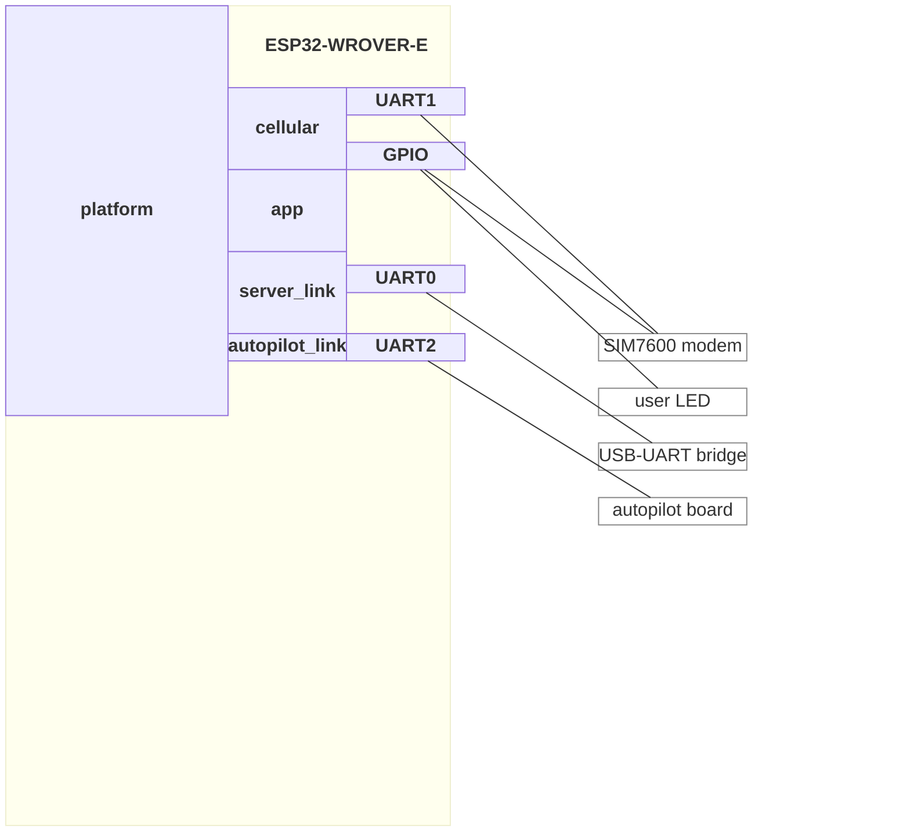

## Level 2, subsystems: v15

v14a works: platform stretches beside the subsystem column, cellular beside its two buses, server_link beside UART0 and a gap. Two side effects: Mermaid gives every child of a group the same size, so the title (a child of the processor block) became as tall as the whole body, and the devices (in a block the size of the processor) became huge. v15: the title is the top row of the subsystem column, so it is one row tall; the devices sit in the middle of three columns, each row a device or a gap, so they are row-sized; padding 0 (default padding, v14b, looked worse).

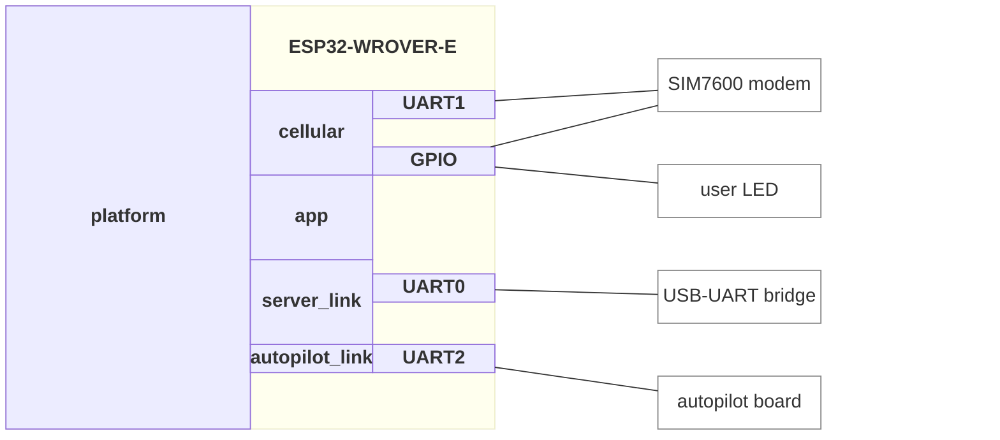

## Level 2, subsystems: v14 (boxes stretch vertically)

The user's idea: a box beside a group grows to the group's height (Mermaid docs, "column width dynamics"), so boxes can stretch vertically too, and the hardware edge goes back to the right with the devices outside it.

- platform is used by all four other subsystems: it stands on the left, as tall as the column of subsystems beside it, touching each.
- The subsystems stack cellular, app, server_link, autopilot_link, so the connected pairs touch (cellular–app, app–server_link, server_link–autopilot_link) and the others don't.
- cellular drives UART1 and GPIO: it is as tall as the two with a gap between them. server_link gets a gap under UART0, so UART0 and UART2 don't touch.
- app drives no bus: a gap on its right.

Invisible groups do the stretching (no fill, no border).

v14a, padding 0:

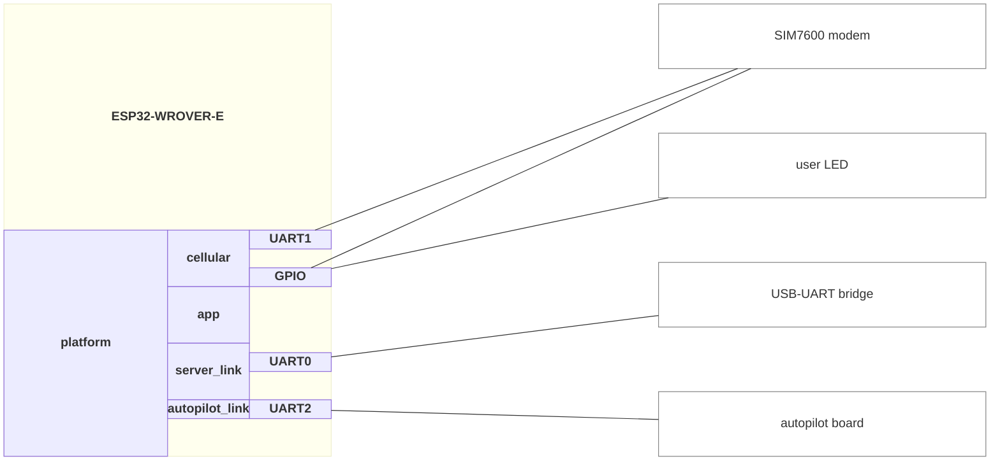

v14b, default padding:

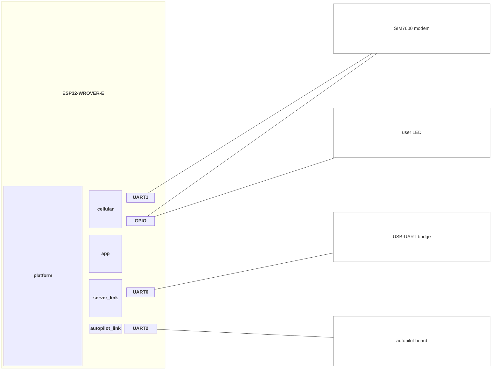

## Level 2, subsystems: v13

v12 (default padding) lost them too, so padding is not the cause. Likely cause: when the devices block comes out wider than the processor block, Mermaid stretches the processor block without widening its spanning boxes. In v5a the devices block was the narrower one. v13 wraps the device names onto two lines so the devices block stays narrower than the processor, and sets padding 0 again.

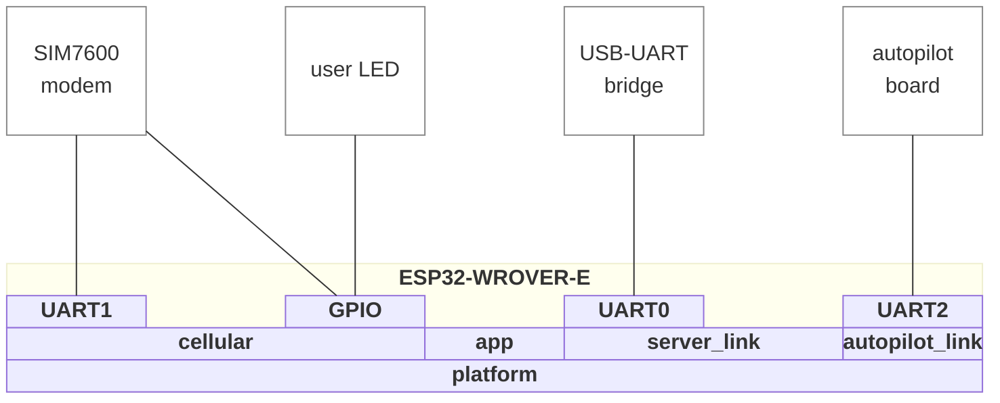

## Level 2, subsystems: v12

v11 (padding 1) still lost the spans. v12 is the same with Mermaid's default padding, as in v5a, which kept them.

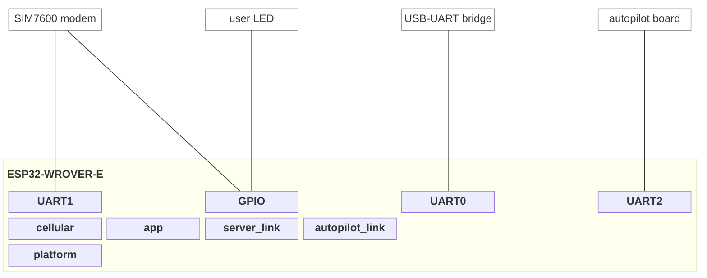

## Level 2, subsystems: v11

v10 still lost the spans. The cause is padding 0: v5a, with default padding, kept them, and v5b to v10 all used padding 0. v11 is v9 with padding 1: boxes that touch are 1 px apart.

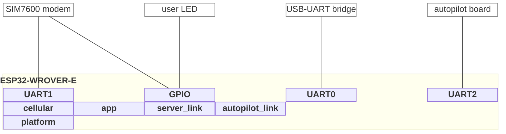

## Level 2, subsystems: v10

v9 still lost the spans. The one difference left from v5b is that v5b's device row had a box spanning two columns (`sim7600:2`). v10 tests that: SIM7600 spans two columns, followed by a gap, in an eight-column device row.

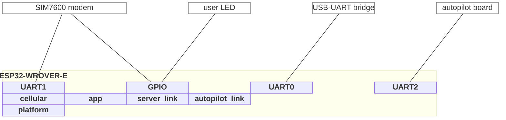

## Level 2, subsystems: v9

v8 still lost the spans, so `space:7` was not the cause. v9 is v5b exactly (outer `space` row between the devices and the processor), changing only the device row so SIM7600 and user LED no longer touch.

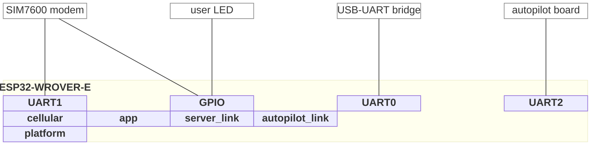

## Level 2, subsystems: v8

v7 still lost the spans. v6 and v7 share `space:7`, which v5b (spans right) did not have; v8 writes the empty row as seven single `space` blocks.

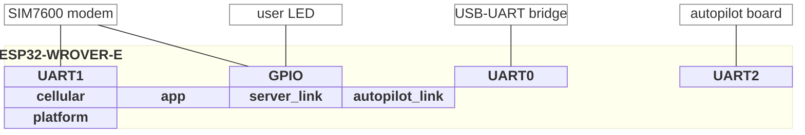

## Level 2, subsystems: v7

v6 problem: a composite block that spans several outer columns ignores its inner column spans (cellular and platform shrank to one cell). v7 goes back to v5b's structure (a devices block above the processor block, padding 0), with a gap between every two devices, and the gap above the processor as an empty row inside the devices block instead of an outer space row (which drew far too tall).


## Level 2, subsystems: v6

v5 problems: the devices sat far above the processor, the SIM7600 and user LED boxes touched although they are not connected, and with Mermaid's default padding touching boxes still had a thin gap. v6: one grid of seven columns, so each device sits over its bus; a gap between every two devices; padding 0, so boxes that touch really touch.

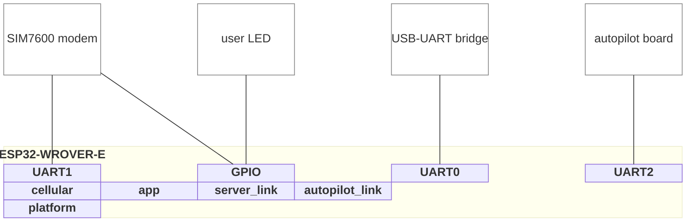

## Level 2, subsystems: v5 (touch only when connected)

Rule from the user: two boxes touch only when they are connected; otherwise a gap. Connected: a component in one depends on a component in the other (either way), or a subsystem drives a bus. A box spans as many columns as it needs to touch everything it connects to.

The gateway has such a layout. Box sizes come only from the connections: platform is used by all four other subsystems, so it spans the whole width under them; cellular drives two buses, so it spans both and the gap between them.

- Touching, all connected: app–platform, app–server_link, app–cellular, server_link–platform, autopilot_link–server_link, autopilot_link–platform, cellular–platform; cellular–UART1, cellular–GPIO, server_link–UART0, autopilot_link–UART2.
- Gaps, not connected: app–autopilot_link, cellular–server_link, cellular–autopilot_link, every bus–bus pair, app and every bus.

A box can't span rows in block-beta, so a box used by many grows sideways and the layers stack top to bottom. The hardware edge is therefore the top: buses in the top row, devices above the processor. platform, which drives no bus, sits at the bottom, furthest from the hardware; app drives none either and has a gap above it.

v5a, Mermaid's default padding between boxes (touching boxes still have a thin gap; a real gap is a whole empty cell):

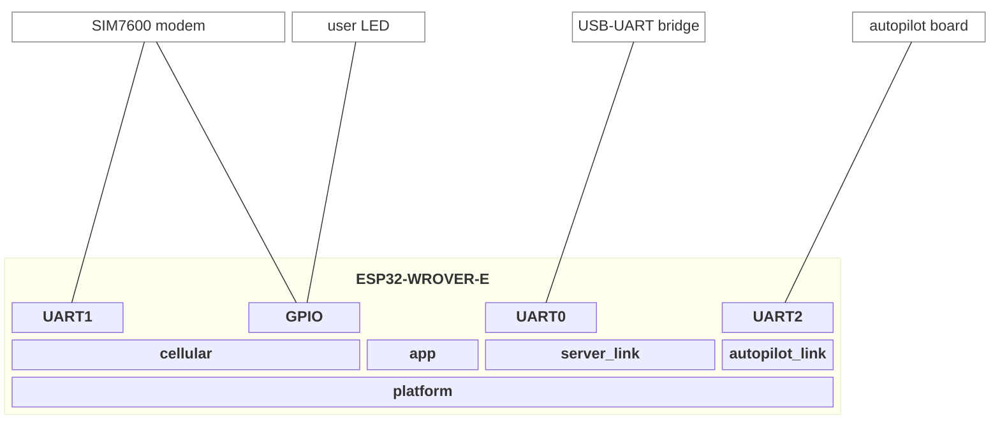

v5b, the same with the padding between boxes set to 0, so touching boxes really touch:

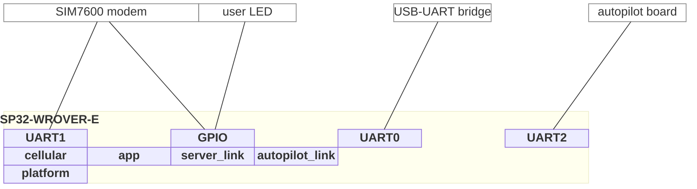

## Level 2, subsystems: v4

v3 change, from the user: every box inside the processor (subsystems and buses) in Mermaid's default block style with a bold label, as the subsystems were in v2; devices outside stay plain outlines.

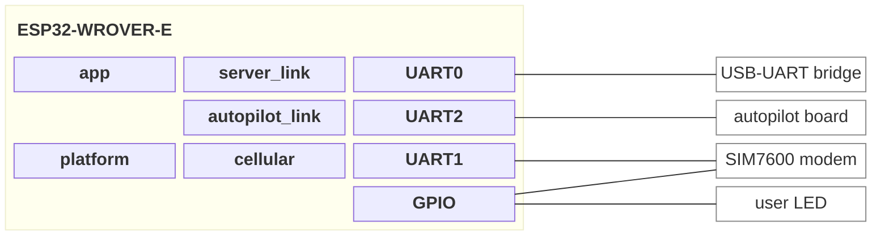

## Level 2, subsystems: v3

v2 change, from the user: one style for every box. Subsystems, buses and devices are all plain outlines with plain labels; only the processor's title is bold.

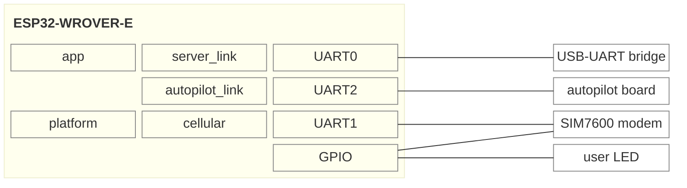

## Level 2, subsystems: v2

v1 changes, from the user: no lines inside the processor, and every box solid. Placement alone ties a subsystem to the bus beside it; lines only leave the processor, from a bus to its devices.

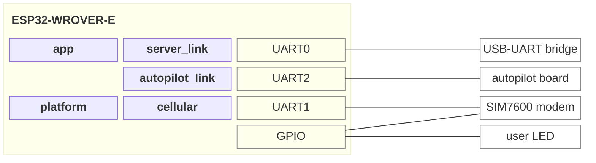

## Level 2, subsystems: v1

1a and 1b stay as they are (flowcharts). Level 2 in block-beta, as a grid inside the processor: the subsystems that drive no bus (app, platform) in the inner column, each bus-driving subsystem in the middle column on the same row as its bus, the bus boxes at the processor's edge, and the devices outside, on their bus's row.

```mermaid
block-beta
  columns 5
  block:cpu:3
    columns 3
    title["<b>ESP32-WROVER-E</b>"]:3
    app["<b>app</b>"] server_link["<b>server_link</b>"] uart0["UART0"]
    space autopilot_link["<b>autopilot_link</b>"] uart2["UART2"]
    platform["<b>platform</b>"] cellular["<b>cellular</b>"] uart1["UART1"]
    space space gpio["GPIO"]
  end
  space
  block:devs
    columns 1
    space
    ch9102["USB-UART bridge"]
    autopilot_board["autopilot board"]
    sim7600["SIM7600 modem"]
    user_led["user LED"]
  end
  server_link --- uart0
  autopilot_link --- uart2
  cellular --- uart1
  cellular --- gpio
  uart0 --- ch9102
  uart2 --- autopilot_board
  uart1 --- sim7600
  gpio --- sim7600
  gpio --- user_led
  classDef title fill:none,stroke:none
  classDef bus fill:none,stroke:#888,stroke-dasharray:3 3
  classDef device fill:none,stroke:#888
  classDef group fill:none,stroke:none
  class title title
  class uart0,uart2,uart1,gpio bus
  class ch9102,autopilot_board,sim7600,user_led device
  class devs group
```

## Step 1, v2

v1 problems: the SIM7600's two lines join the same two boxes, so they overlap ("tGPIOI"); the device groups get a yellow composite fill. v2: the processor is a composite of three invisible rows, so each line ends at its own height; the groups have no fill or border.

```mermaid
block-beta
  columns 5
  block:left
    columns 1
    sim7600["SIM7600 modem"]
    space
    ch9102["USB-UART bridge"]
  end
  space
  block:cpu
    columns 1
    r1[" "]
    r2["<b>ESP32-WROVER-E</b>"]
    r3[" "]
  end
  space
  block:right
    columns 1
    user_led["user LED"]
    space
    autopilot_board["autopilot board"]
  end
  sim7600 -- "UART1" --- r1
  sim7600 -- "GPIO" --- r2
  ch9102 -- "UART0" --- r3
  r1 -- "GPIO" --- user_led
  r3 -- "UART2" --- autopilot_board
  classDef device fill:none,stroke:#888
  classDef port fill:none,stroke:none
  classDef group fill:none,stroke:none
  class sim7600,ch9102,user_led,autopilot_board device
  class r1,r2,r3 port
  class left,right group
```

## Step 1: level 1a, hardware

The processor and the devices outside it, one line per bus. The ESP32-WROVER-E module has integrated 16 MB flash and 8 MB PSRAM.

```mermaid
block-beta
  columns 5
  block:left
    columns 1
    sim7600["SIM7600 modem"]
    space
    ch9102["USB-UART bridge"]
  end
  space
  cpu["<b>ESP32-WROVER-E</b>"]
  space
  block:right
    columns 1
    user_led["user LED"]
    space
    autopilot_board["autopilot board"]
  end
  sim7600 -- "UART1" --- cpu
  sim7600 -- "GPIO" --- cpu
  ch9102 -- "UART0" --- cpu
  cpu -- "GPIO" --- user_led
  cpu -- "UART2" --- autopilot_board
  classDef device fill:none,stroke:#888
  class sim7600,ch9102,user_led,autopilot_board device
```

## Test: edge labels

A. Labelled arrow, the docs' syntax `a -- "UART1" --> b`:

```mermaid
block-beta
  columns 3
  a["modem"] space b["processor"]
  a -- "UART1" --> b
```

B. Labelled line without an arrowhead, `a -- "UART1" --- b`:

```mermaid
block-beta
  columns 3
  a["modem"] space b["processor"]
  a -- "UART1" --- b
```

C. Composite block with a title, `block:cpu["ESP32-WROVER-E"]`:

```mermaid
block-beta
  columns 3
  a["modem"] space
  block:cpu["ESP32-WROVER-E"]
    columns 1
    u["UART1"]
  end
  a -- "UART1" --> u
```
