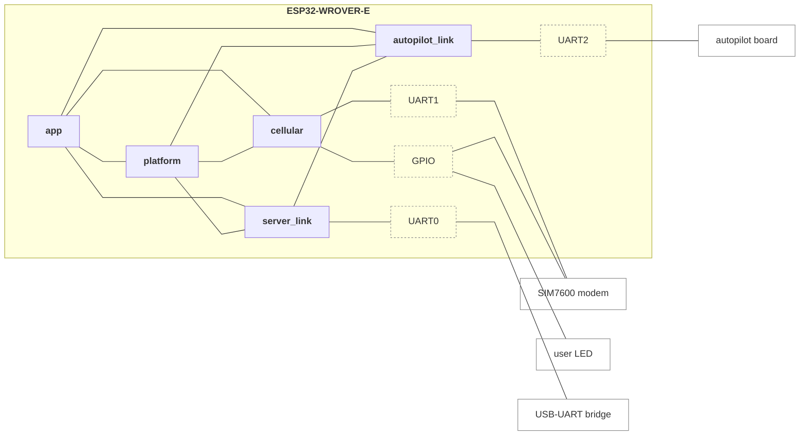
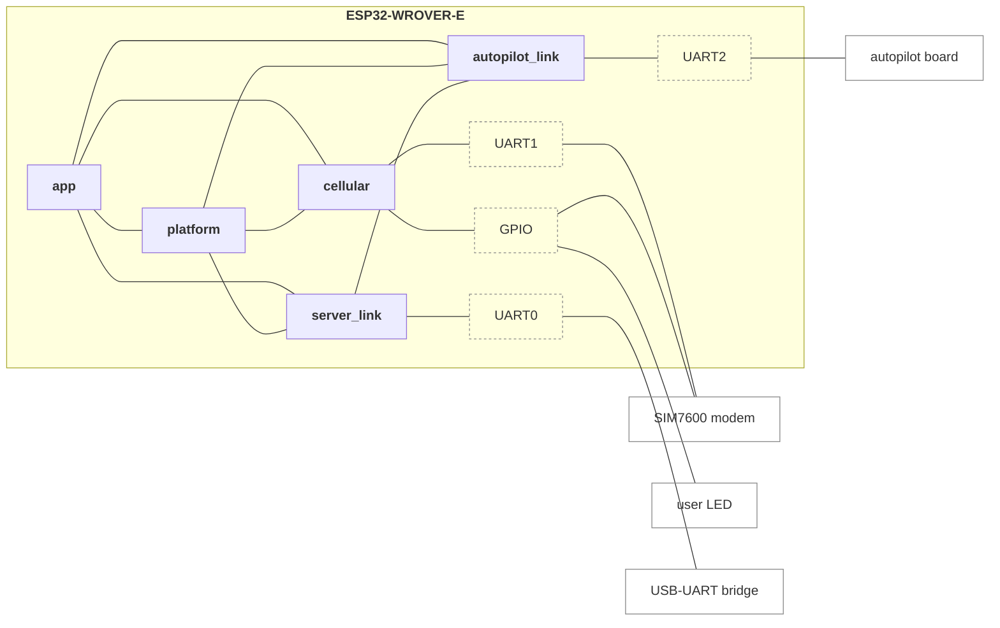

# Level 2 line-curve experiments

Scratch, not for merging. Same graph as c40e978; only the init line differs.

## I curve basis

## J curve linear

## K curve linear, rankSpacing 80

## L curve monotoneX

## M curve basis, rankSpacing 80, nodeSpacing 40

