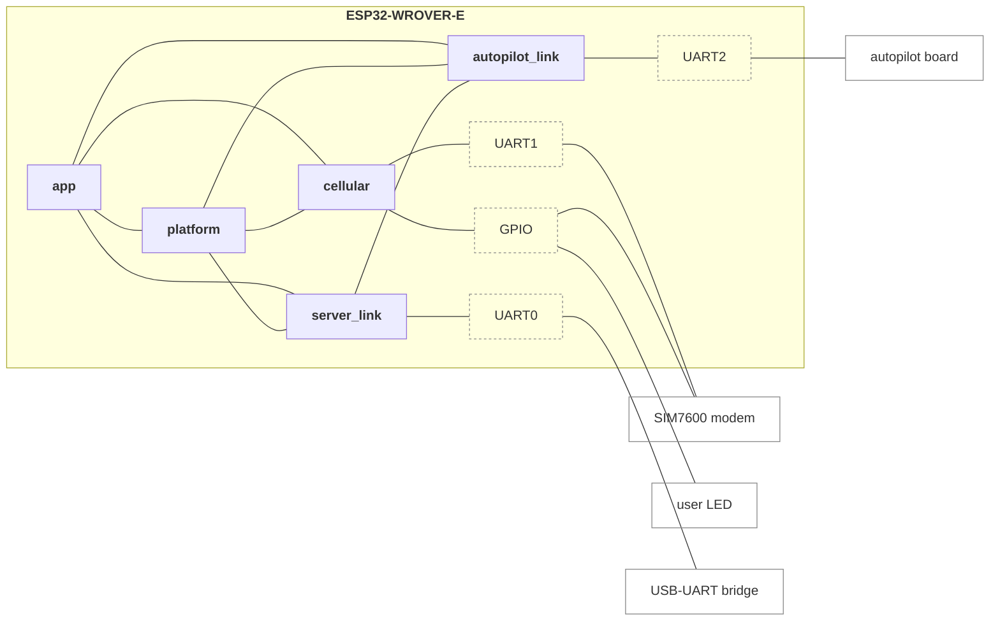
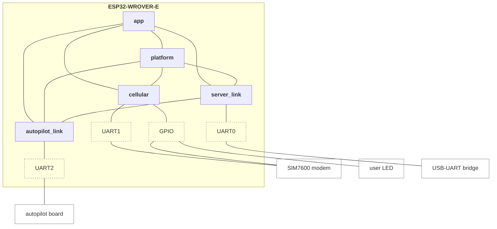

# Level 2 line-curve experiments, part 2

Scratch, not for merging.

## N frontmatter curve linear

## O per-edge curve linear on subsystem lines

## P per-edge curve basis on subsystem lines

## Q direction TB

