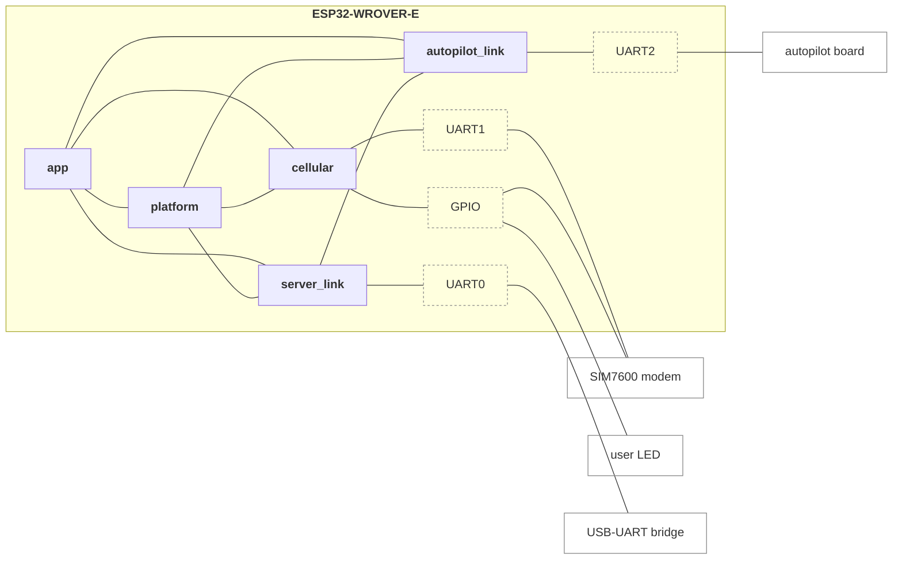
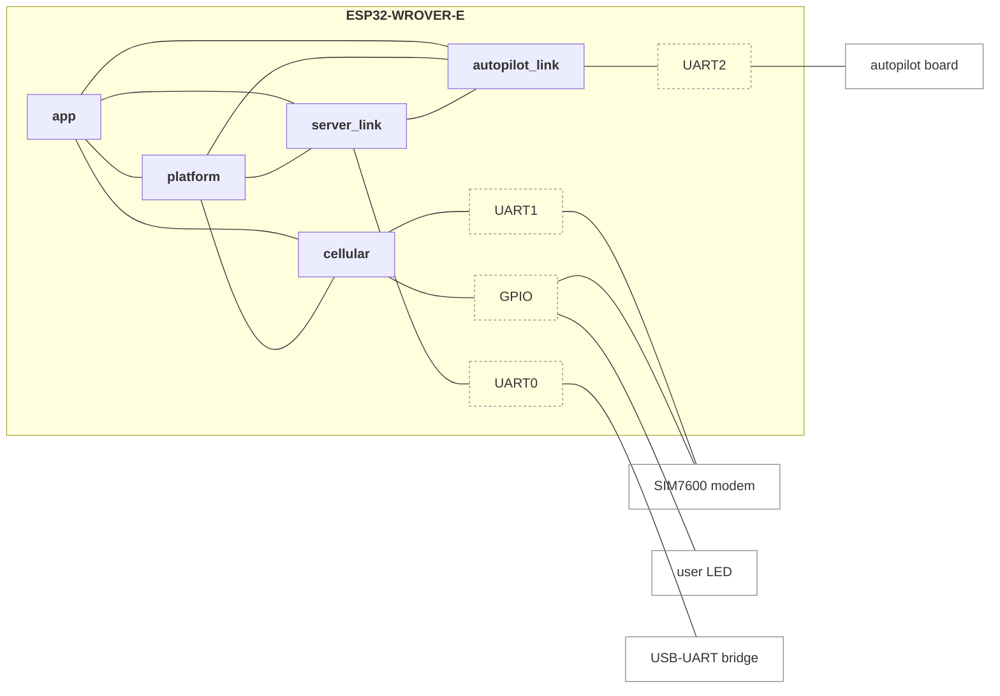
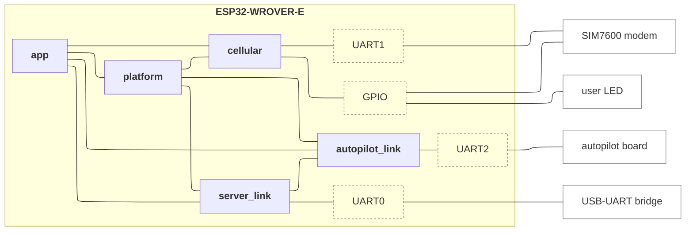

# Level 2 line-order experiments

Scratch, not for merging.

## A baseline (c40e978)

## B declare by connection count

## C B + lines grouped by subsystem

## D C + line direction by declaration order

## E C + subsystem lines before bus lines

## F C without invisible links

## G D without invisible links

## H C with ELK layout

